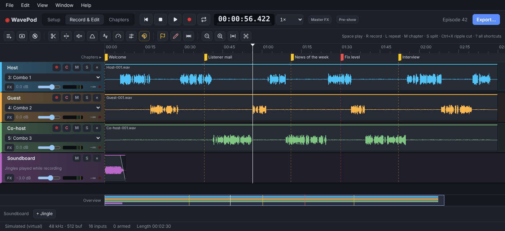
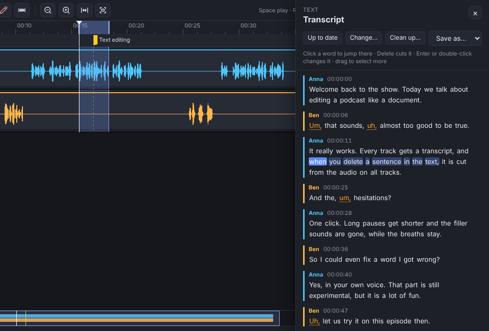
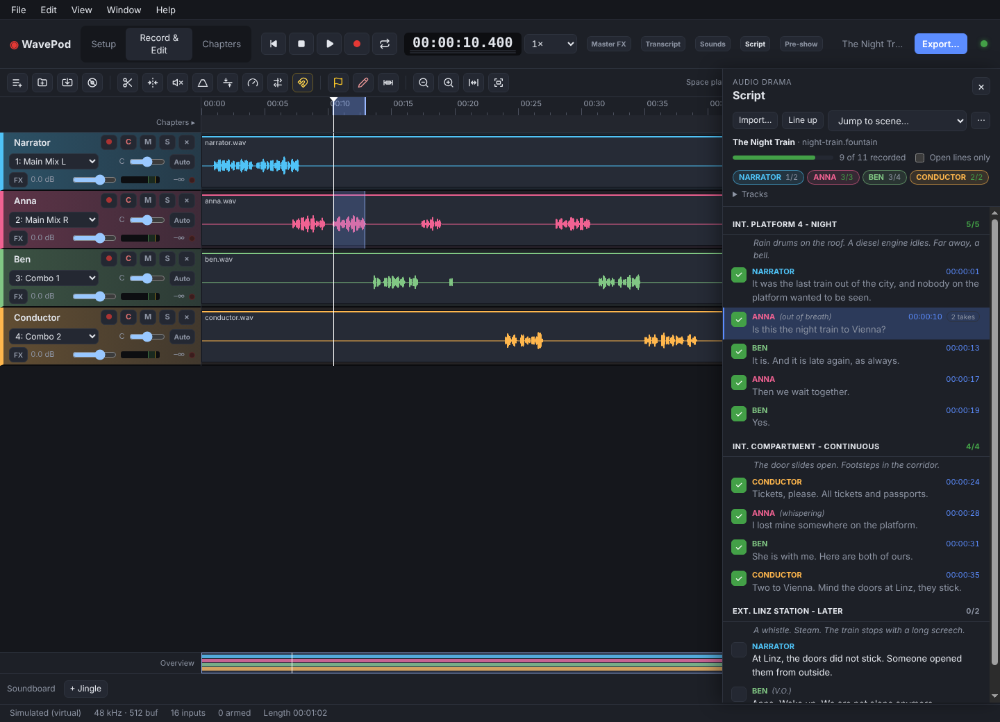
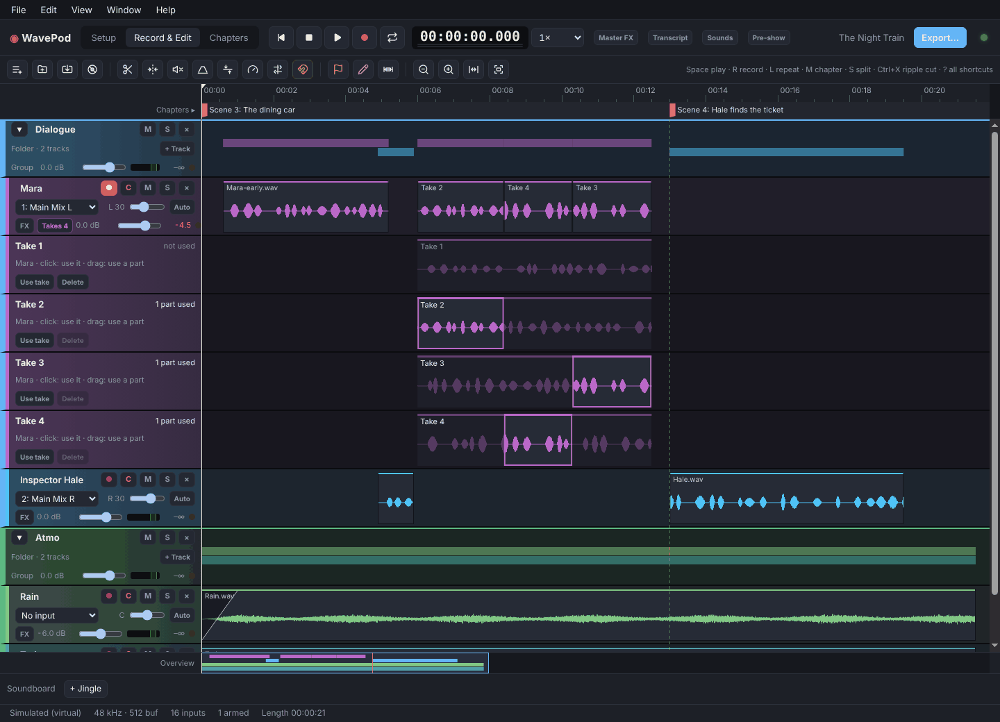

# WavePod

**Record and edit your podcast or audio drama like a document.** WavePod is
a free, open-source multitrack recorder and editor for Linux, Windows and
macOS. Everything [Ultraschall](https://ultraschall.fm/) is loved for, as one
app you install and start, with no Reaper underneath.

**[Download WavePod](https://github.com/michaelkleinhenz/wavepod/releases/latest)**
· [Website](https://michaelkleinhenz.github.io/wavepod/)
· [User guide (wiki)](https://github.com/michaelkleinhenz/wavepod/wiki)



### What makes it different

- **Edit by text.** Get a transcript, delete words to cut the audio, and
  clean up pauses, ums and retakes in one go. Crosstalk is filtered out
  per speaker.
- **Every mic on its own track, in one click.** All 16 channels of a
  RØDECaster Pro II, a Zoom PodTrak, a Focusrite or any other multichannel
  USB interface, with channels recognised and named.
- **Recording you can trust.** Each take is written to disk as it happens and
  recovered after a crash. If an input drops out or the disk fills up,
  WavePod raises a loud alarm instead of failing silently.
- **Built-in post-production.** Leveler, noise reduction, de-esser, EQ,
  compressor and a true-peak limiter on every track, plus your own VST3
  plug-ins, which run in a separate process so a crashing plug-in can't take
  a recording down. You don't need a paid online service to make it sound
  finished.
- **Made for audio drama too.** Import a script and tick off lines as you
  record. Keep every take and comp the best parts. Punch in, use voice
  effects and convolution reverb, and pull from a sound effects library.
  Export dialogue, music and effects stems.
- **Remote guests and video.** Send a guest an invite link: you talk over a
  live call while their browser records their microphone untouched, and that
  recording lands on their track, lined up. Import several cameras (or let
  CamPod record them) and get a video podcast whose picture follows every
  audio edit, with a director lane and MP4 export.

<table>
  <tr>
    <td width="33%"></td>
    <td width="33%"></td>
    <td width="33%"></td>
  </tr>
  <tr>
    <td align="center"><b>Edit by text</b>: select words, press Delete</td>
    <td align="center"><b>Script</b>: tick off lines as you record</td>
    <td align="center"><b>Takes</b>: comp the best parts</td>
  </tr>
</table>

### Everything a podcast needs

- Chapter markers while recording (`M`), a soundboard whose jingles land in
  the recording, and cough buttons that mute you live but can be undone later.
- Fast editing: ripple cut, snapping, crossfades, volume lines, automation,
  track folders, tape-style scrubbing, and listening at up to 3× speed.
- Loudness done right: EBU R128 analysis and export to −16 LUFS or any other
  target, mono or stereo.
- One export: MP3, FLAC, Opus or WAV with chapters, chapter images and cover
  art embedded, plus Podlove, Podcasting 2.0 and mp4chaps chapter files.
  Split a recording into regions and export each one as its own file.
- A mix-minus feed for guests in the studio, sync for tracks from separate
  recorders, templates for your show, and MIDI, OSC and Stream Deck control.
- Optional MCP server, so AI agents like Claude can build filter chains and
  read your episode.

The **user guide** explains every feature step by step. In the app it opens
with **Help › WavePod Help** (`F1`, at the page for the view or dialog you are
in), with a contents list and full-text search. Online it is the
**[WavePod wiki](https://github.com/michaelkleinhenz/wavepod/wiki)**, made from the same pages in
[docs/guide/](docs/guide/README.md):

- [Installation](https://github.com/michaelkleinhenz/wavepod/wiki/Installation) and [Getting started](https://github.com/michaelkleinhenz/wavepod/wiki/Getting-started)
- [Recording](https://github.com/michaelkleinhenz/wavepod/wiki/Recording), [Editing clips](https://github.com/michaelkleinhenz/wavepod/wiki/Editing-clips) and
  [Tracks and mixing](https://github.com/michaelkleinhenz/wavepod/wiki/Tracks-and-mixing)
- [Filters and effects](https://github.com/michaelkleinhenz/wavepod/wiki/Filters-and-effects),
  [Audio drama](https://github.com/michaelkleinhenz/wavepod/wiki/Audio-drama) and
  [Transcript and text editing](https://github.com/michaelkleinhenz/wavepod/wiki/Transcript-and-text-editing)
- [Remote guests](https://github.com/michaelkleinhenz/wavepod/wiki/Remote-guests) and
  [Video podcasts](https://github.com/michaelkleinhenz/wavepod/wiki/Video-podcasts)
- [Chapters and markers](https://github.com/michaelkleinhenz/wavepod/wiki/Chapters-and-markers),
  [Loudness](https://github.com/michaelkleinhenz/wavepod/wiki/Loudness) and [Exporting](https://github.com/michaelkleinhenz/wavepod/wiki/Exporting)
- [Keyboard shortcuts](https://github.com/michaelkleinhenz/wavepod/wiki/Keyboard-shortcuts) and
  [Troubleshooting](https://github.com/michaelkleinhenz/wavepod/wiki/Troubleshooting)

See [docs/PLAN.md](docs/PLAN.md) for the architecture and roadmap.

## Getting started

WavePod is ready to use: download it, install it like any other app and
start it. You don't need to build anything.

> **WavePod is beta software.** Always make a backup recording of every show
> with something else, for example on your mixer's SD card or a second
> recorder.

### 1. Download

Get the file for your computer from the
[latest release](https://github.com/michaelkleinhenz/wavepod/releases/latest)
(under **Assets**):

| Computer | File to download |
| --- | --- |
| Windows 10 or 11 (64-bit) | `WavePod-<version>-win-x64.exe` |
| Mac with Apple silicon (M1 or newer) | `WavePod-<version>-mac-arm64.dmg` |
| Ubuntu, Debian, Linux Mint, Pop!_OS | `WavePod-<version>-linux-amd64.deb` |
| Other Linux (Fedora, Arch, …) | `WavePod-<version>-linux-x86_64.AppImage` |

There is no build for Macs with an Intel processor yet.

> **Windows 11 users:** if **Smart App Control** is switched on, Windows blocks
> WavePod without offering "Run anyway". See
> [Windows: Smart App Control blocks WavePod](#windows-smart-app-control-blocks-wavepod)
> before you install.

### 2. Install and start

WavePod's installers are not signed with a code-signing certificate, so
Windows and macOS warn you the first time. That is expected; the steps below
get you past it once. (Why aren't they signed? See
[Why WavePod isn't code-signed](#why-wavepod-isnt-code-signed).)

**Windows**

1. Double-click the downloaded `.exe`.
2. If Windows shows "Windows protected your PC", click **More info**, then
   **Run anyway**.
3. Follow the installer. You can choose where WavePod goes.
4. Start WavePod from the Start menu or the desktop shortcut.

If Windows instead says **"Smart App Control blocked an app that may be
unsafe"** and there is no **Run anyway** button, see
[Windows: Smart App Control blocks WavePod](#windows-smart-app-control-blocks-wavepod).

**macOS**

1. Double-click the downloaded `.dmg` and drag **WavePod** onto
   **Applications**.
2. Open WavePod from Applications or Launchpad. macOS says it can't check
   the app for malicious software; click **Done** (or **OK**).
3. Open **System Settings › Privacy & Security**, scroll down to the message
   about WavePod and click **Open Anyway**, then confirm with your password.
   (On older macOS versions you can instead right-click WavePod in
   Applications and choose **Open**.)
4. When WavePod asks to use the microphone, click **Allow**. Without it,
   recordings stay silent. You can change this later under **System Settings
   › Privacy & Security › Microphone**.

If macOS says WavePod "is damaged and can't be opened", the download was
quarantined. Run this once in Terminal and open WavePod again:

```sh
xattr -cr /Applications/WavePod.app
```

**Ubuntu, Debian and other Debian-based Linux**

1. Double-click the `.deb` to install it with your software centre, or run
   this in a terminal in your Downloads folder:
   ```sh
   sudo apt install ./WavePod-*-linux-amd64.deb
   ```
2. Start WavePod from the app grid / applications menu, or run `wavepod`.

Prefer the `.deb` on Ubuntu: it installs WavePod under `/opt/WavePod`, adds
it to the app grid, and installs the AppArmor profile Ubuntu 23.10+ needs to
run it (the AppImage crashes there with `SIGTRAP`).

**Other Linux (AppImage)**

1. Install FUSE 2 if your system doesn't have it (Ubuntu:
   `sudo apt install libfuse2t64`, Fedora: `sudo dnf install fuse-libs`).
2. Make the file executable and start it:
   ```sh
   chmod +x WavePod-*-linux-x86_64.AppImage
   ./WavePod-*-linux-x86_64.AppImage
   ```
   Most file managers can do the same: **Properties › Permissions › Allow
   executing file as program**, then double-click it.

The AppImage doesn't add itself to the app menu; see
[GNOME launcher](#linux-gnome-launcher-for-the-appimage) if you want that.

### 3. First start

WavePod opens with a short beta notice, then on **Setup › Project**:

1. Type a name under **Start a new episode** and create it.
2. On **Setup › Audio**, pick your interface under **Record from** and your
   headphones under **Listen on**. Speak into each mic and watch the meters.
3. Click **Create speaker tracks**, switch to **Record & Edit** (`Ctrl+2`)
   and press `R` to record.

Press `F1` at any time for the built-in user guide; its
[Getting started](docs/guide/getting-started.md) page walks you through the
first episode. No interface at hand? You can still try editing with your own
audio files: **File › Import Audio…** or drag them onto the timeline.

On Linux, keep **Audio driver** on **System default** unless you know you
need something else (see [Linux: which audio driver](#linux-which-audio-driver)).

### Updating and uninstalling

To update, download the new release and install it over the old one (on
Linux: `sudo apt install ./WavePod-*.deb` again, or replace the AppImage).
Your episodes and settings are kept: episodes live in `Documents/WavePod`.

To remove WavePod, use **Settings › Apps** on Windows, drag it from
Applications to the Bin on macOS, or run `sudo apt remove wavepod` on
Debian/Ubuntu. Your episodes in `Documents/WavePod` stay where they are.

### Windows: Smart App Control blocks WavePod

Smart App Control is a protection in Windows 11 that only lets apps run that
are code-signed or that Microsoft already knows. Because WavePod isn't
signed, Smart App Control blocks it, and unlike the "Windows protected your
PC" screen, it has **no way to allow a single app**. The only way to run
WavePod is to switch Smart App Control off:

1. Open **Windows Security** (search for it in the Start menu).
2. Go to **App & browser control › Smart App Control settings**.
3. Choose **Off**.
4. Start the WavePod installer again. If "Windows protected your PC" appears,
   click **More info › Run anyway**.

Your other protection, including Microsoft Defender Antivirus and SmartScreen,
stays on. Only turn Smart App Control off if you trust the download: get
WavePod only from the
[official releases page](https://github.com/michaelkleinhenz/wavepod/releases).

Can you turn it back on later? On an up-to-date Windows 11 you can switch it
on again on the same page. On older Windows 11 versions, turning it off was
permanent until Windows was reset or reinstalled. Keep in mind that while it is on, WavePod (and every
update of it) is blocked again.

Not sure whether Smart App Control is on? The same page shows **On**,
**Evaluation** or **Off**. Most PCs that were upgraded from Windows 10 have
it off already, and then you only see the "Windows protected your PC" screen.

### Why WavePod isn't code-signed

Signing an app so that Windows and macOS trust it right away costs money every
year: a Windows code-signing certificate costs a few hundred euros a year,
and Apple's Developer Program costs 99 USD a year. WavePod is a free,
open-source project without income, so it can't pay for that. The builds are
made by GitHub Actions straight from the public source code in this
repository, so you can always check what you install, or
[build it yourself](#build-from-source).

For a RØDECaster Pro II with all 16 channels, also install RØDE's ASIO
driver (see [Using a RØDECaster Pro II](#using-a-rødecaster-pro-ii)).

### Using a RØDECaster Pro II

1. Enable multitrack mode in the RØDECaster's USB audio settings
   and connect it over USB.
2. In WavePod's **Setup** view, on the **Audio** tab, pick the RØDECaster
   under **Record from**.
3. Further down the **Audio** tab the 16 channels appear with their names and
   live meters. Click **Create speaker tracks**: each mic and remote source
   gets its own armed track.
4. Switch to **Record & Edit** and press `R`.
5. When the recording is done, run **Edit › Prepare All Tracks for Editing**
   (or the toolbar button) to unarm all tracks, so `R` can't start a new take
   while you cut. Tick **Prepare for Editing When Recording Stops** in the
   same menu to have this happen automatically.

On Windows the multitrack channels are only exposed through RØDE's ASIO
driver; pick **ASIO** as **Audio driver** (Setup › Audio › Advanced audio
settings) if it is offered.

### Linux: which audio driver

On a desktop with PipeWire or PulseAudio running, the sound server keeps the
sound cards to itself. "System default" then uses PulseAudio / PipeWire, which
reaches every device with all its inputs (e.g. a RØDECaster Pro II in its
multitrack profile). Over ALSA only the server's shared "Default ALSA Device"
is left (stereo, no separate inputs), and Setup says so. Pick ALSA only when no
sound server runs.

## Build from source

For developers and anyone who wants to run the current `main` branch.

```sh
git clone https://github.com/michaelkleinhenz/wavepod.git
cd wavepod
make install   # npm ci
make start     # build and run
make demo      # run with virtual devices only, no audio hardware needed
make test      # unit + engine tests
make dist      # build installers for this OS into release/
make help      # all targets
```

Requires Node.js 22, CMake and a C++ compiler: `npm ci` compiles a patched copy
of the `audify` audio module (see `patches/` and `scripts/build-audify.mjs`;
the upstream prebuilt binary crashes under Electron 43+). `npm install` or
`npm rebuild` can put that prebuilt back; `make build` and every `make dist*`
notice this and compile the patched copy again before bundling. On Linux this also
needs the ALSA and PulseAudio headers: `sudo apt install libasound2-dev
libpulse-dev pkg-config` on Debian/Ubuntu, `sudo dnf install alsa-lib-devel
pulseaudio-libs-devel pkgconf` on Fedora. If the JACK headers are installed too
(`libjack-jackd2-dev`, or `pipewire-jack-audio-connection-kit-devel` on Fedora),
the build also includes JACK; they are optional. VST3 support needs the helper in `native/vsthost`:
`make vsthost` builds it (CMake 3.25+ and a C++17 compiler; it downloads
Steinberg's VST3 SDK), and `make dist*` builds it automatically. Without it
WavePod runs fine, just without the VST3 entry. On Linux the app needs `libasound2` and `libpulse0`
(present on normal desktop installs).

### Linux: Chromium sandbox

Electron sandboxes its renderer processes. On Linux it does this with
unprivileged user namespaces, or, where those are blocked, with the setuid
helper `node_modules/electron/dist/chrome-sandbox`, which must be owned by
root. Ubuntu 23.10+ blocks user namespaces through AppArmor, and npm installs
the helper as your user, so plain `npx electron .` aborts with
`SIGTRAP` ("The SUID sandbox helper binary was found, but is not configured
correctly"). WavePod itself never needs root. `make start` detects this and
prints the options instead of crashing:

- Keep the sandbox (redo after every `npm ci`):
  ```sh
  sudo chown root:root node_modules/electron/dist/chrome-sandbox
  sudo chmod 4755 node_modules/electron/dist/chrome-sandbox
  ```
- Keep the sandbox permanently by allowing user namespaces for this Electron
  binary with an AppArmor profile (run from the repo root):
  ```sh
  sudo tee /etc/apparmor.d/wavepod-electron-dev >/dev/null <<EOF
  abi <abi/4.0>,
  include <tunables/global>
  profile wavepod-electron-dev "$PWD/node_modules/electron/dist/electron" flags=(unconfined) {
    userns,
    include if exists <local/wavepod-electron-dev>
  }
  EOF
  sudo apparmor_parser -r /etc/apparmor.d/wavepod-electron-dev
  ```
- Development only, without the sandbox: `WAVEPOD_NO_SANDBOX=1 make start`.

### Linux: GNOME launcher for the AppImage

The AppImage does not add itself to the app grid. To get WavePod (with its
icon) into GNOME's Activities and dock, run this in a checkout of this
repository:

```sh
make desktop-install WAVEPOD_EXEC=$HOME/Applications/WavePod.AppImage
make desktop-uninstall   # to remove it again
```

This copies `build/linux/wavepod.desktop` and the icons into
`~/.local/share`. The entry's `StartupWMClass` and `Icon` are `wavepod`,
matching `desktopName` in `package.json`, so running windows group under the
launcher.

### App icon

`build/icon.svg` is the one source for the app, installer and web page icon.
After editing it, `make icons` re-renders `build/icons/*.png`,
`build/icon.png`, `build/icon.ico`, the favicons in `site/` and copies the SVG
to `site/img/icon.svg` (needs Playwright's Chromium and ImageMagick). A test
checks the web copy matches. The icon has no lettering, so renaming the app
only touches `productName`, `desktopName` and the `.desktop` file.

## Keyboard

| Key | Action |
| --- | --- |
| `Space` | Play / stop (playback stops at the end of the last clip) |
| `R` | Record / stop recording |
| `L` | Repeat: loop playback of the selected time range |
| `M` | Chapter marker at playhead |
| `E` | Edit marker at playhead |
| `S` | Split clips at playhead (selected clips' tracks, or all) |
| `F` | Fade in/out on selected clips |
| `Delete` / `Shift+Delete` | Delete selection / ripple delete range |
| `Ctrl/Cmd+X` | Ripple cut: remove the selected range from all tracks and close the gap |
| `Ctrl/Cmd+Y` | Mute the selected range on its tracks via their volume lines |
| `1`–`9`, `Esc` | Soundboard slots (again: fade out), stop all jingles |
| `Shift`+`1`–`9` (hold) | Cough button for speaker track 1–9 |
| `←` `→` (with `Shift`) | Move playhead 1 s (10 s) |
| `+` `-`, `Ctrl/Cmd`+wheel | Zoom (down to single samples) |
| `Ctrl/Cmd+Z`, `Shift+Ctrl/Cmd+Z` | Undo / redo |

Drag across the ruler to select a time range; drag clips to move them
(also to another track), drag clip edges to trim. Muted (cough) regions
sit in the strip at the bottom of each track: drag there to add one, drag
its edges to adjust it, double-click or `Delete` to remove it.

## MIDI controller

Any class-compliant USB MIDI controller (pad controller, keyboard, foot
switch, a mixer's MIDI out) can start and stop recording and drop chapter
and edit markers; play/pause, stop, record on/off, the cough buttons of
speakers 1–6 (muted while held) and soundboard slots 1–9 can be mapped too.
In **Edit → Settings… → Controllers → MIDI controller**, click *Learn* next to a function and press
the pad, key or button. Notes fire on note-on, controllers when they go
to 64 or above (once per press, so a fader doesn't repeat), program
changes always. A mapping listens to the device it was learned from;
switch it to *Any device* (tick *Show device and button type*) if you use
more than one. Mappings are stored in
the app settings, not in the episode, so they work in every project.

## Remote control (OSC)

For a Stream Deck through [Bitfocus Companion](https://bitfocus.io/companion)
(a *Generic OSC* connection), TouchOSC or anything else that sends OSC over
UDP, switch on **Edit → Settings… → Controllers → Stream Deck and OSC remotes**. WavePod
listens on port 9000 (changeable under *Connection details and addresses*), only for this computer unless *Accept from other computers*
is ticked. Addresses:

| Address | Does |
| --- | --- |
| `/wavepod/record`, `/wavepod/record/start`, `/wavepod/record/stop` | Record on/off, start, stop |
| `/wavepod/play`, `/wavepod/stop` | Play/pause, stop |
| `/wavepod/marker/chapter`, `/wavepod/marker/edit` | Drop a marker |
| `/wavepod/prepare` | Prepare for editing |
| `/wavepod/cough/1` … `/6` | Cough button: argument 1 mutes the speaker, 0 releases |
| `/wavepod/sound/1` … `/9`, `/wavepod/sounds/stop` | Soundboard slot, stop all sounds |

A button that sends 1 on press and 0 on release fires once; a message
without arguments counts as a press.

## Auphonic

**File → Send to Auphonic…** creates a multitrack production on
[auphonic.com](https://auphonic.com) with one FLAC per track (track filters
and volume rendered in), the chapters, the episode details and the cover.
Paste the API key from Auphonic's Account Settings once; pick one of your
multitrack presets and whether to start the production right away or review
it on the website first.

## Audio drama

**Voices.** "+ Add filter" in the FX panel has a *Voice effects* group: telephone, mobile phone, old radio, walkie-talkie, megaphone, next room, robot, broken robot, alien, giant, demon, small creature, child-like voice, chipmunk, magic, ghost, time travel, dream and more. Each one adds a few ordinary filters set from factory presets, so every value stays editable. The building blocks are also filters of their own: Band-pass, Distortion, Echo, **Pitch shift** (−24 to +24 semitones, speed kept), **Ring modulator** (robots, aliens) and **Chorus / flanger** (chorus, flanger, vibrato).

**Places.** The *Places* group puts a voice into a room with the **Room & distance** filter: living room, bedroom, small kitchen, bathroom, car, office, classroom, stairwell, basement, garage, church, concert hall, cave, tunnel, forest, open field and street. Its **Distance** (in metres) moves the speaker away: the voice gets quieter, loses highs and bass, and the room takes over; below 1 m it gets the bass of speaking close to the mic. Filters work per track and per clip, so one clip can be further away than the next.

**Real rooms.** The **Convolution reverb** filter puts a voice into a recorded room: load an impulse response (a WAV or AIFF file of a room, car, hall or church; free collections such as OpenAIR have hundreds). IRs live in Documents/WavePod/Impulse responses, so every episode, template and preset can use them.

**Sound library.** Set a folder of sound effects in Edit › Settings, then open View › Sound Library (Shift+Ctrl+B, or *Sounds* in the header). Type to search file and folder names ("door creak", "forest wind"); ↑/↓ walk the results and play each one, Enter or a double click inserts the sound at the playhead, and a row can be dragged onto any track. *Insert on* picks the track (by default a "Sound effects" track, created when needed). Right click › *Fill the Selection (Loop)* repeats an atmosphere over the selected time range with crossfades. Inserted sounds are copied into the episode, so it keeps working without the library.

**Sound design on clips.** Right click a clip › *Sound design*: *Reverse* plays it backwards, *Speed…* is varispeed like tape (pitch follows speed; type 1.5, 80 % or semitones like +3 st), and *Loop* turns the clip into a loop, so dragging its right edge repeats it. *Loop to next clip* fills the gap up to the next clip on the track (or to the end of the episode), *Loop over selection* fills a time range you selected before right-clicking. Dragging a clip's edge past the end of its audio (or its left edge past the start) turns it into a loop on its own: the clip repeats to fill the length you drag it to, which is the quick way to lay an ambience under a scene. Loop seams get a short crossfade, and *Play as recorded* undoes all of it. Fades, the volume line, splits and trims work on these clips as usual.

## Crosstalk removal (automix)

When several people share a room, every mic also picks up the others. Tick
**Automix (remove crosstalk)** in the FX panel of each speaker track: whoever is
loudest stays at full level and the other automixed tracks are turned down by up
to the chosen depth (−6 to −40 dB). Two people talking at once both stay up,
and short pauses inside a sentence don't close a track. It runs in playback,
the mix export and stem exports, after each track's filters. AI agents can set
it with the MCP tool `set_automix`.

## Transcript

**View → Transcript** (Shift+Ctrl+T) shows the episode as text, one paragraph
per speaker turn. **Transcribe** sends each speaker track to
[ElevenLabs speech-to-text](https://elevenlabs.io/speech-to-text) (Scribe) as a
16 kHz mono WAV and brings back every word with its time; only files without a
transcript are sent. Put your ElevenLabs API key into **Edit → Settings…**
(Ctrl+,), together with the model, the language and names the model should get
right. The key is kept encrypted with the system keychain where there is one.

Transcripts are stored per recorded file in the episode's `transcripts/`
folder, in that file's own time, so they stay right through every cut, move
and trim. In the panel, click a word to jump there, drag across words to select
their time, and press Delete to cut the selection out of all tracks.
Hesitations are underlined. **Save as…** writes the text with speakers and
times, or WebVTT subtitles. The MCP tool `get_transcript` gives AI agents the
text (for show notes or chapter titles).

### Changing words (experimental)

Double-click a word in the transcript (or click it, or select several, and press
Enter, or use **Change…**) to replace it or to insert new words before or after
it. [ElevenLabs text-to-speech](https://elevenlabs.io/docs/api-reference/text-to-speech/convert)
says them in the speaker's voice: either an instant voice clone made from up to
90 seconds of that track's own transcribed speech (you confirm that you have the
speaker's permission; the clone is remembered on the track and can be deleted
from your ElevenLabs account again), or any voice of your account. The speaker's
words around the edit are sent along so the intonation fits.

**Listen** plays the take; **Replace**/**Insert** puts it in: the silence around
it is trimmed, the clip gain matches the speaker's level around the edit, the
range is cut out of (or room made on) every track so they stay in sync, and the
cut edges get short fades. The new clip is in `media/tts-….wav` with a
transcript of its own, so it shows up in the text. Ctrl+Z undoes it. Takes are
24 kHz unless *High quality* (44.1 kHz, ElevenLabs Pro plan) is on, and each one
costs text-to-speech credits.

## Cleanup

**Edit → Clean Up Pauses and Hesitations…** (Shift+Ctrl+K) lists:

- pauses in the mix longer than a set length (1.5 s by default), shortened to a
  set length (0.7 s) by cutting out their middle, so breaths at both ends stay;
- hesitations from the transcript (äh, ähm, öhm, hm; uh, um, erm in English),
  each cut moved onto the quiet points around the sound. If someone else talks at
  that moment, the hesitation is muted on its own track instead of cut.

Listen to each with ▶, untick what should stay, then **Apply** (one undo step)
or **Mark only** (edit markers to decide by hand).

## Zencastr

**File → New Episode from Zencastr ZIP…** turns a session downloaded from
Zencastr (Library → Recordings → Download) into a new episode: one track per
participant (the WAV when the ZIP has both WAV and MP3), the soundboard
recording on the Soundboard track, all starting at 0 as in the session. When
someone left and rejoined, their parts go one after the other on their track,
placed by the time in the file names. Transcripts, video and post-production
mixes are left out.

## Remote guests

**View → Remote Guests** (Shift+Ctrl+G) records guests who aren't in the
room. The live call runs over [LiveKit](https://livekit.io) with your own
project (LiveKit Cloud's free plan or your own `livekit-server`; URL, key and
secret go into **Edit → Settings… → Remote guests**). Press **Open Session**,
type a guest's name and **Invite**: WavePod adds an armed track marked
*Remote* and copies an invite link to the guest page on wavepod.de. The guest
opens it in Chrome, Edge, Firefox or Safari, picks a microphone and waits
until you **Let In**. Nothing to install, no account.

While you record, each guest's browser records their microphone untouched and
uploads it during the take. When you stop, it goes on their track as a take,
lined up with the call, so the episode gets full microphone quality instead
of call quality. A guest who reloads the page mid-take keeps recording into a
second part, placed where it belongs. Video is optional, only for eye
contact, and never recorded; host and guests can pick their camera and switch
microphones during the call.

## Video podcasts

**File → Import Camera Video…** (or a drop on the timeline) adds camera files
(MP4, MOV, MKV, WebM with H.264, VP9 or AV1). Each camera gets a muted sound
track tagged *Camera*, and **Sync cameras…** lines every camera up with a
microphone recording over the whole length, clock drift included. From then
on the picture follows its sound: every cut, deleted word, cleaned-up pause or
comped take cuts the video too.

The **director lane** says which camera is seen when. Fill it by hand, by
watching through and pressing 1–9 to switch cameras live, or with
**Auto-direct**, which cuts to whoever speaks (with a wide shot for crosstalk
and long stretches). The Export dialog writes an MP4 (H.264 or AV1) next to
the audio files, with the same mix.

[CamPod](https://github.com/michaelkleinhenz/campod), a multi-camera recorder
for a Linux box with USB cameras, plugs in under **Edit → Settings… →
Cameras**: Record in WavePod starts its cameras under the episode's name, and
**File → Import from CamPod…** downloads a recording's camera files into the
episode, places them at the take and syncs them.

## AI agents (MCP)

WavePod can run a [Model Context Protocol](https://modelcontextprotocol.io)
server so an AI agent can work on the open episode, mainly its filter
stacks: "give every speaker the voice chain, put a gentle compressor after
the de-esser on the guest and a limiter at −1 dB on the master, then check
the loudness".

It is off by default. Switch it on in **Edit → Settings… → AI agents**. The
server listens on `http://127.0.0.1:47474/mcp` (the port can be changed
under *Connection details*) and only accepts connections from this computer; requests from web
pages are refused. Any program on your computer can connect while it is on,
so switch it off when you don't use it.

Every change an agent makes is one undo step (`Ctrl/Cmd+Z`), shows up in
the FX panel at once and is announced with a short message at the bottom.

**Claude Code**

```sh
claude mcp add --transport http wavepod http://127.0.0.1:47474/mcp
```

**Claude Desktop** (and other clients that only start local commands):
add this to `claude_desktop_config.json` (Settings → Developer → Edit
Config) and restart Claude Desktop. It needs Node.js for `npx`.

```json
{
  "mcpServers": {
    "wavepod": {
      "command": "npx",
      "args": ["-y", "mcp-remote", "http://127.0.0.1:47474/mcp"]
    }
  }
}
```

Clients that speak Streamable HTTP directly (Cursor, VS Code, …) just need
the URL. WavePod has to be running, with the server switched on, when the
client connects.

| Tool | What it does |
| --- | --- |
| `get_project` | Episode name, folder, sample rate, length, metadata, transport state |
| `list_tracks` | Tracks and the master with gain, pan, mute/solo, clips and filter names |
| `list_markers` | Chapter and edit markers with timestamps |
| `measure_loudness` | EBU R128 figures of the mix and every track, after the filters |
| `list_filter_types` | Built-in filters with parameter keys, units, ranges and defaults |
| `list_vst_plugins` | Installed VST3 effects |
| `get_filter_stack` | One stack with all values (VST3 values also as the plug-in's own text) |
| `add_filter` | Add a built-in filter or a VST3 plug-in, at a position, with values |
| `update_filter` | Change parameters, bypass or enable |
| `remove_filter`, `move_filter` | Remove or reorder |
| `apply_voice_chain` | High-pass, De-esser and Dynamics, appended or replacing the stack |
| `set_filter_stack` | Replace a whole stack in one step |
| `copy_filter_stack` | Copy a track's filters to another track or the master |
| `list_filter_presets` | Factory presets or the plug-in's own programs, plus the user's presets, for one filter |
| `apply_filter_preset` | Load a preset into a filter (by id or name) |
| `save_filter_preset` | Save a filter's settings as a user preset (same name replaces) |

Stacks are addressed by track name, track id or `master`; filters by id,
or by type or plug-in name when that is unique in the stack. Built-in
parameters use their real units (Hz, dB, ms, LUFS) and are clamped to the
ranges the sliders allow; VST3 parameters are normalized 0–1 and addressed
by id or title, as with the generated sliders (plug-in editors are never
opened).

## Recording safety

Recordings are built to survive crashes, power cuts and full disks:

- A worker thread writes every input buffer to the WAV files as it arrives, so a crash of the app (even `kill -9`) loses at most a few milliseconds. Headers are updated every second and everything is forced to the disk every 2 seconds, so a power cut loses at most about 2 seconds.
- Files over 4 GB become RF64 automatically.
- While a take runs, `recording-in-progress.json` in the project folder lists its files. If WavePod finds it when a project opens, the take was interrupted: the files are repaired and put back on their tracks, and a dialog says so. A backup of the project from before the recovery is kept in `backup/`.
- If the disk fills up, audio is held in memory (up to 1 GB) and written as soon as there is space again. WavePod won't start a take with less than a minute of space left.
- If the audio interface drops out mid-take (a USB reset or a loose cable), the take keeps running with silence, so the tracks stay in time with the clock and with a guest's own recording. WavePod reconnects as soon as the device is back, also under a new device id, and the gap gets a ⚠ edit marker.
- Closing the window mid-take asks first; Ctrl+C, SIGTERM and logout stop the take and save; a crashed window reloads while recording continues.

While recording, a bar under the toolbar warns about dropouts (audio the device never delivered), crackle, clipping, inputs that get no signal, a stalled input device, a slow or nearly full disk and write errors. The status bar shows how much recording time the disk has left. When the take stops, every problem spot gets a ⚠ edit marker so you can listen to it.

## Projects

Each episode is a folder (default `~/Documents/WavePod/Episode …`) with
`project.json` and a `media/` folder of WAV files. Changes are saved
automatically.

WavePod used to be called SoundPod. If you still have a
`~/Documents/SoundPod` folder and no `~/Documents/WavePod`, WavePod keeps
using the old folder, episodes and templates included. Settings (devices,
MIDI mappings, last episode) are copied from the old SoundPod app-data
folder on the first start.

Templates live in `~/Documents/WavePod/Templates/<name>/`: a
`template.json` plus a `sounds/` folder with copies of the jingles, so a
template keeps working when the original jingle files move. A new episode
gets its own copies in its `sounds/` folder. Copy a template folder to share
it with another machine; input channels are matched by number, so it fits
best on the same audio interface.

## Releases

Pushing a tag like `v0.1.0` runs `.github/workflows/release.yml`, which
builds a Linux AppImage and .deb, a Windows NSIS installer and a macOS DMG and
attaches them to a GitHub release. Builds are unsigned until signing
certificates are configured as repository secrets.

The app version comes from the tag: the workflow sets `package.json`'s
`version` to the tag without its `v` before packaging, so tagging `v0.7.0`
builds an app whose Help › About shows 0.7.0.

To cut a release, run this on an up-to-date `main` with a clean working tree:

```sh
make release VERSION=0.7.0
```

It sets `package.json` and `package-lock.json` to the new version, commits
that as "Release v0.7.0", creates the tag `v0.7.0` and pushes the commit and
the tag together, which starts the release workflow. It refuses to run on
another branch, with uncommitted changes, when `main` differs from
`origin/main`, or when the tag already exists, and asks before changing
anything (`YES=1` skips the question).

## Third-party components

- [audify](https://github.com/almoghamdani/audify) (RtAudio bindings, MIT)
- [LAME](https://lame.sourceforge.io/) (MP3 encoder, LGPL) as WebAssembly from
  [wasm-media-encoders](https://github.com/arseneyr/wasm-media-encoders) (MIT),
  bundled into the export worker
- [opusscript](https://github.com/abalabahaha/opusscript) (libopus 1.4 as
  WebAssembly, MIT; libopus itself is BSD-3-Clause) for the Opus export
- [VST3 SDK](https://github.com/steinbergmedia/vst3sdk) (MIT), used by the
  VST3 host helper
- the Dynamics filter (`src/core/fx/ultraschallDynamics.ts`) is a port of the
  Ultraschall Dynamics JSFX and stays under its original LGPL license
- some toolbar icons come from [Lucide](https://lucide.dev) (ISC)

Copyright notices and license texts are in
[THIRD_PARTY_NOTICES.md](THIRD_PARTY_NOTICES.md) and [LICENSES/](LICENSES);
release builds ship them next to the app.

## License

WavePod is open source under the [MIT License](LICENSE), except for the
third-party parts listed above, which keep their own licenses.

VST is a registered trademark of Steinberg Media Technologies GmbH. RØDECaster,
Auphonic, Zencastr, Ultraschall and the other product names mentioned here are
trademarks of their respective owners, used only to describe compatibility.
WavePod is not affiliated with or endorsed by any of them.
